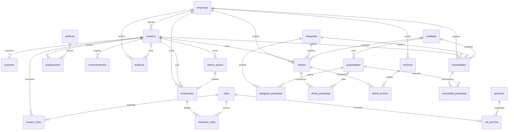
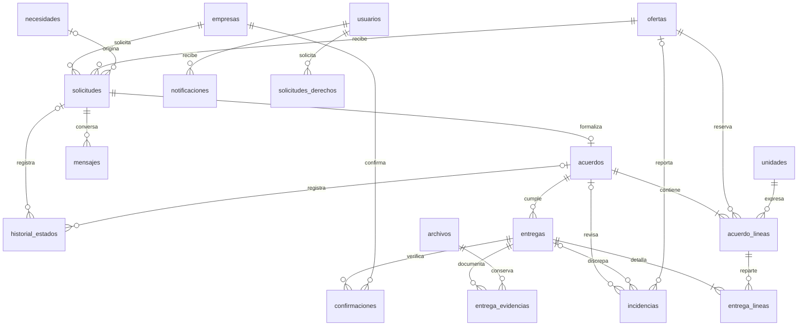

# DER implementado local — 2026-11-26

Subconjunto implementado del DER del anteproyecto v1.2. No representa todavía
acuerdos, entregas, documentos/RAG, agentes ni gobernanza completa. Se conservan
los PDF originales. Diagrama editable; las migraciones especifican columnas,
tipos, FK, índices y restricciones.

## Migraciones y extensiones

- `20261124000100-roles-permisos.js`: roles, permisos, rol_permiso.
- `20261124000200-identidad-empresas.js`: empresas, usuarios, usuario_roles,
  sesiones, politicas, aceptaciones, consentimientos. ADR 0007 explica el nombre
  `refresh_hash` del DER para el hash de sesión; no hay flujo de refresh.
- `20261124000300-equipo-invitaciones-auditoria.js`: tokens_accion,
  invitaciones, invitacion_roles, auditoria. ADR 0008 documenta emisor,
  revocación y detalle mínimo de auditoría.
- `20261126000100-materiales-catalogo.js`: categorias, unidades, propiedades,
  categoria_propiedad, ofertas, oferta_propiedad, archivos, oferta_archivo,
  necesidades y necesidad_propiedad. ADR 0009 documenta definiciones activas,
  declaraciones del oferente y retiro lógico de fotos.

36 tablas de dominio tras las migraciones de operación y derechos. `SequelizeMeta` y `SequelizeData` son metadatos de ejecución.
DECIMAL(14,3) en cantidades; DECIMAL(14,2) en precios; DECIMAL(14,4) en propiedades.
La API usa cadenas y BigInt escalado para operaciones que requieren exactitud.

Oferta/propiedad: texto o decimal según definición, nunca ambos. Necesidad:
texto o intervalo con al menos un extremo; mínimo no supera máximo.
Disponibilidad: total menos reservado y entregado. Los acumuladores cambian solo mediante reserva/cancelación y recepción bilateral
confirmada; nunca son editables directamente desde el navegador.
La evidencia de reservas y entregas corresponde a ADR 0011 y sus pruebas.

Las FK secundarias de actor, asignado_por y aceptada_por apuntan a usuarios;
se resumen líneas para legibilidad. Las migraciones detallan todas las referencias.
Retirar fotos conserva vínculos y bloquea descarga. No hay purgas automáticas.

## Extensión operativa y de derechos — 2026-11-26

Migración `20261126000200-operacion-empresarial.js`: once tablas nuevas.
Migración `20261126000300-solicitudes-derechos.js`: una tabla nueva.

Diccionario de ampliación:

- `solicitudes`: oferta, necesidad opcional, empresa solicitante, creador,
  cantidad DECIMAL(14,3), propuesta/condiciones, estado, versión, proponente,
  snapshot JSON y fechas. No reserva al crear.
- `acuerdos`: solicitud única, modalidad, condiciones y fecha aceptadas, estado,
  versión aceptada y fechas. La unicidad impide formalización duplicada.
- `acuerdo_lineas`: acuerdo, oferta, unidad y ambas empresas, cantidad
  DECIMAL(14,3), precio DECIMAL(14,2)/moneda y ficha histórica JSON.
- `mensajes`: solicitud, autor, contenido y fecha; solo participantes autorizados.
- `historial_estados`: solicitud o acuerdo (exclusión mediante CHECK), actor,
  estados anterior/nuevo, motivo y fecha. No editable por cliente.
- `entregas`: acuerdo, creador, fecha, estado, clave idempotente única y huella
  SHA-256 de entrada; fechas de registro. Anulada conserva evidencia y no descuenta.
- `entrega_lineas`: entrega/línea de acuerdo únicas, cantidad, masa y método,
  factor kg/unidad DECIMAL(14,6) y fuente. Cantidad y masa DECIMAL(14,3).
- `confirmaciones`: entrega, empresa, usuario, recepción/uso, conformidad,
  observación y fecha; unicidad entrega/empresa/tipo. Reapertura archiva la
  decisión anterior en auditoría y exige reconfirmación, sin atribuirla al moderador.
- `entrega_evidencias`: PK compuesta entrega/archivo y descripción. Archivo privado
  con validación y almacenamiento local existentes; autorización al descargar.
- `incidencias`: reportante y revisor opcionales, referencias a oferta/acuerdo/
  entrega, motivo, estado, resolución y fechas. Asignación concurrente controlada.
- `notificaciones`: usuario, tipo/canal, evento, estado, ruta y fechas. Unicidad
  usuario/canal/evento; no implica envío de correo ni seguimiento comercial.
- `solicitudes_derechos`: usuario, empresa opcional, tipo, estado, detalle,
  verificación, creación, resolución y fecha de cierre opcional. FK RESTRICT.
  Recibir/revisar no ejecuta supresión; no se registra cierre ficticio.

Las migraciones son la definición exhaustiva de tipos, nulabilidad, índices,
FK y CHECK. No hay `sync` destructivo. Modelos documentales, agentes e
integraciones del DER del anteproyecto siguen pendientes de sus entregas.
La migración PostgreSQL necesita un baseline y verificación independientes;
este esquema documenta la implementación MySQL local actual.
## Extensión de mensajería — 2026-11-27

`20261127000100-mensajeria-idempotente.js` añade `clave_cliente VARCHAR(36)`
nullable a mensajes; unicidad `(autor_id,clave_cliente)` e índice `(solicitud_id,id)`.
Los registros anteriores conservan NULL; no se trasladan ni borran. Siguen
siendo 36 tablas de dominio. La solicitud identifica su conversación, también
cuando existe acuerdo; no se mezclan negociaciones diferentes.

La API nueva requiere UUID de envío. Igual autor/clave/solicitud/contenido retorna
el mensaje previo; otra entrada devuelve 409. Rutas anteriores compatibles.
# Ampliación IA local — 2026-11-27

Ampliación posterior de chat, migración `20261127000400-chat-nori.js`:
`conversaciones_ia` contiene titular/empresa, clave cliente, contexto fijo y su
huella, creación/actualización. `turnos_ia` referencia conversación/titular y
ejecución opcional única; conserva pregunta, UUID único por titular, estado,
error y fecha. Índices conversación/id y titular/id para cursores. Preguntas
privadas recuperables solo por su titular con permisos/contexto vigentes.
La respuesta permanece en la ejecución; no se duplica en cada turno. ADR 0018.

Migración `20261127000300-agentes-ejecuciones.js`:

- `agentes`: id, código único, nombre, versión de prompt. Ocho registros de catálogo;
  su existencia no significa ocho agentes completos.
- `ejecuciones_ia`: FK agente/usuario/empresa nullable; modelo, versión de prompt,
  UUID cliente, hashes de entrada/contexto, estado, duración, tokens, costo nullable,
  error, fecha, fuentes JSON y respuesta privada para reintento. Índice único
  usuario/UUID e índices usuario/fecha y empresa/fecha.

Sin preguntas/prompts completos ni claves. Historial público de API limitado al
titular y a metadatos. Campos del DER documental, `ejecucion_fuentes` con
fragmentos, recomendaciones y reportes vinculados siguen pendientes de RAG y
evaluación, no se sustituyen por tablas ficticias. Ver ADR 0017.
